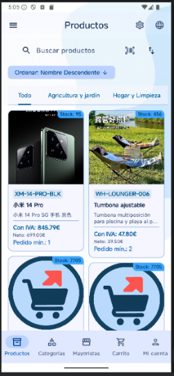
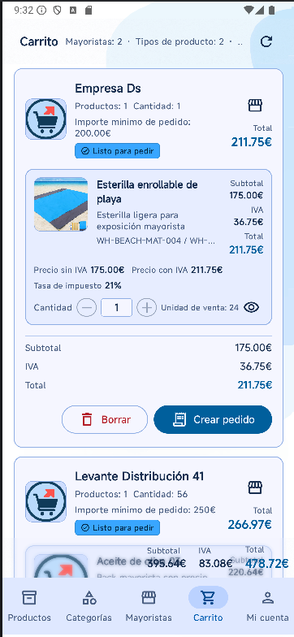
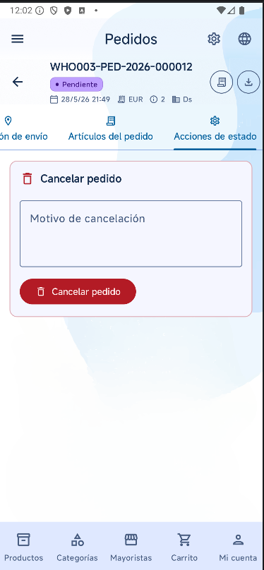
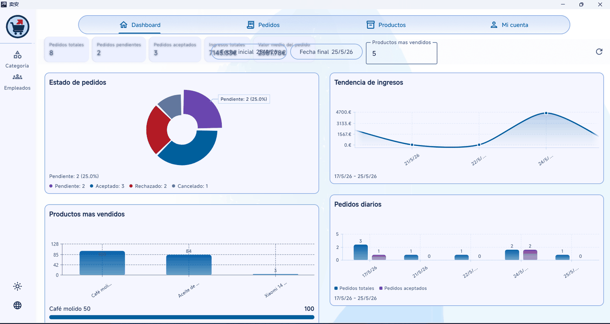
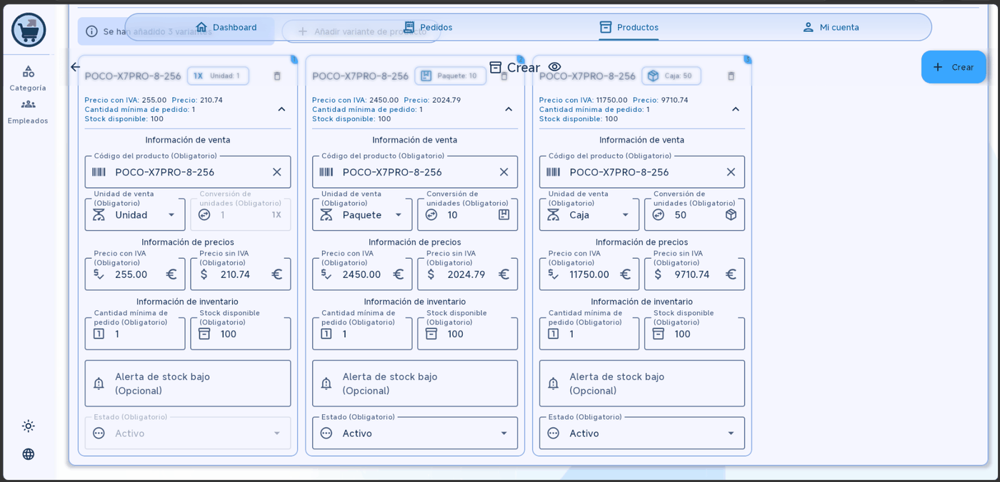
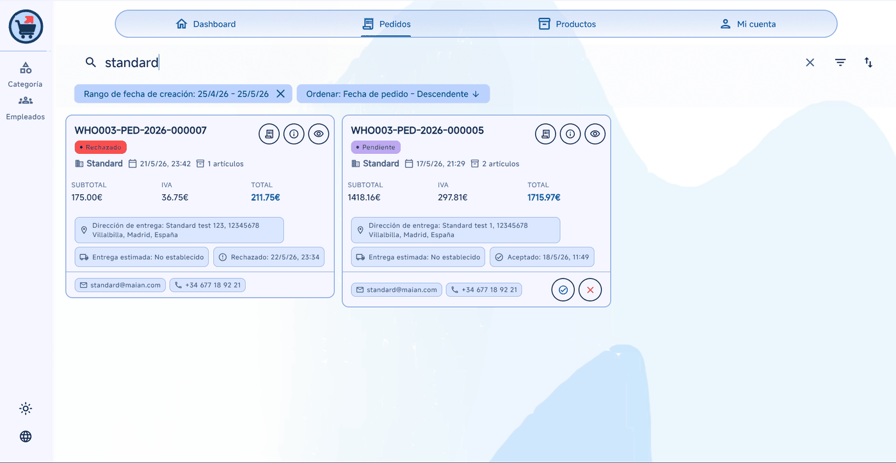
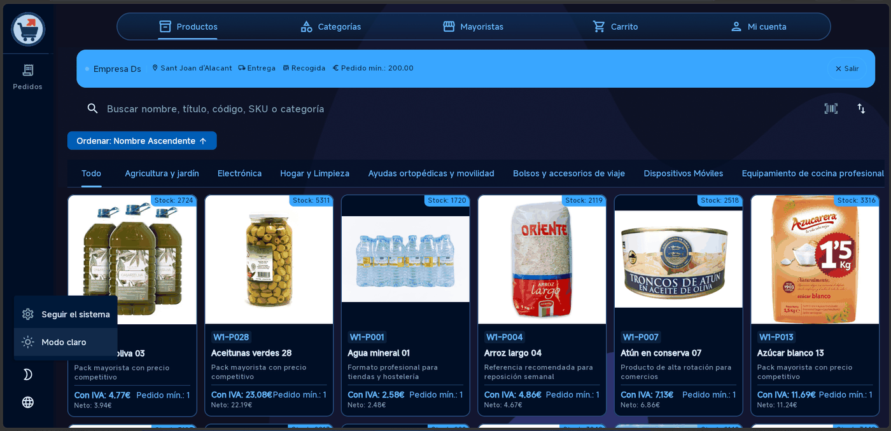
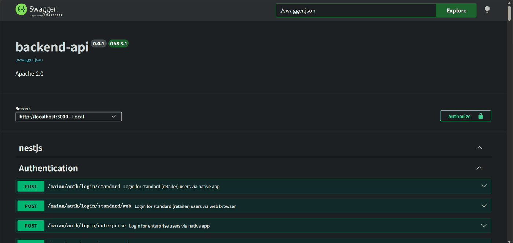

## 1. Project Overview & Motivation

In traditional wholesale distribution, transactions between suppliers (**Wholesalers**) and retail shop owners (**Retailers**) often depend on manual, fragmented processes: outdated printed or PDF catalogues, phone orders, messaging chat threads, manual stock reconciliation, and error-prone invoicing.

**MaiAn** was built to solve this challenge through a unified digital platform. Conceived and delivered as my graduation capstone project (*Memoria del Proyecto Final de DAM*) and continuously evolved as an open-source initiative, MaiAn connects wholesale distributors with retail merchants through dedicated client applications and a centralized, high-throughput cloud API.

The system is deployed and running in production on a self-managed Linux environment with automated containerization.

---

## 2. Live Demos & Credentials

You can test both client web portals directly in your browser:

| Client Portal | Demo Link | Test Account | Password |
|---|---|---|---|
| **Retailer (Standard)** | [Open Retailer Demo](https://maian.dsqrwym.es/standard/) | `standard@maian.com` | `Standard123` |
| **Wholesaler (Enterprise)** | [Open Wholesaler Demo](https://maian.dsqrwym.es/enterprise/) | `enterprise@maian.com` | `Enterprise123` |

> 📦 **GitHub Repository**: [github.com/dsqrwym/Maian](https://github.com/dsqrwym/Maian)

---

## 3. High-Level Architecture

MaiAn was engineered around a clean separation of concerns:

```
┌────────────────────────────────────────────────────────────────────────┐
│                      Kotlin Multiplatform Monorepo                     │
│          Shared Core  ·  Retailer Client  ·  Wholesaler Client         │
│               (Android Native  ·  Desktop JVM  ·  Web Wasm)            │
└───────────────────────────────────┬────────────────────────────────────┘
                                    │ Ktor HTTP Client / REST APIs
┌───────────────────────────────────▼────────────────────────────────────┐
│                    Cloud Backend (NestJS v11 + Fastify)                │
│    Modular Domain APIs  │  CASL Permissions  │  Drizzle ORM Persistence│
└───────────────────┬────────────────────────────────┬───────────────────┘
                    ▼                                ▼
       PostgreSQL 17 Relational DB        Dual Redis (Cache + BullMQ)
```

* **Client Layer**: Written in **Kotlin 2.3+** and **Compose Multiplatform 1.11+**, compiling natively to **Android**, **Desktop (JVM)**, and **Web (Wasm)** from a unified codebase.
* **Backend Tier**: Powered by **NestJS 11** using the **Fastify** engine rather than Express for superior I/O throughput and lower latency.
* **Database & Caching**: **PostgreSQL 17** with **Drizzle ORM** for compile-time type-safe relational queries, combined with **dual Redis instances** (one for sessions and caching, one for BullMQ asynchronous task queues).
* **Zero-Trust Infrastructure**: Containerized with **Docker Compose** on Linux, securely exposed via **Cloudflare Tunnel** with automated TLS and zero open host ports.

---

## 4. Retailer Experience: Frictionless Procurement

The retailer module is designed for quick catalogue exploration, supplier-specific shopping, and automated order splitting.


*Fig 1. Retailer mobile catalogue with instant search, category filters, and product status indicators.*

### Automatic Multi-Wholesaler Cart Splitting
In B2B commerce, retailers frequently purchase goods from different distributors in a single session. MaiAn solves this with an **automatic split-cart engine**:
* When products from multiple wholesalers are added, the cart automatically groups items by distributor.
* Subtotals, minimum order quantities (MOQ), and commercial tax rates are calculated independently per supplier.
* Checkout atomically generates individual purchase orders for each distributor.


*Fig 2. Cart automatically grouping items by wholesaler, with independent sub-order totals.*

### Order Tracking & Document Generation
Retailers can monitor order lifecycles in real time (Confirmed → In Preparation → Shipped → Delivered) and download automated business PDF invoices on demand.


*Fig 3. Real-time order status tracking with cancellation options and automated PDF invoice download.*

---

## 5. Wholesaler Operations: The Backoffice Cockpit

Wholesale distributors have access to a comprehensive backoffice cockpit for inventory management, variant pricing, and order fulfillment.


*Fig 4. Operational dashboard displaying order fulfillment rates, revenue trends via Vico charts, and top-selling SKUs.*

### Product Variant Matrices & Stock Control
Wholesale goods require complex variant configurations (sizes, package units, minimum order tiers). Wholesalers can configure multi-attribute pricing matrices, stock thresholds, and tax codes directly.


*Fig 5. Variant matrix editor for configuring per-size wholesale pricing and stock levels.*

### Order Pipeline & Rejection Handling
Incoming orders follow an explicit state machine. If an order cannot be fulfilled due to inventory or logistical constraints, rejections require a mandatory written justification communicated to the buyer.


*Fig 6. Incoming order pipeline with filtering by commercial status and date.*

---

## 6. Security, Multi-Tenancy & Access Control

B2B platforms require strict data segregation between competing distributors and privacy across independent retail buyers.

* **Role-Based Authentication**: Separate authentication gateways for Retailers, Wholesalers, and Internal Employees (warehouse, delivery, support).
* **Refresh Token Rotation**: Web client sessions use `httpOnly` secure cookies with token rotation on each refresh to prevent session hijacking.
* **Declarative CASL Rules**: Every controller route evaluates granular ability rules before querying data (e.g. `can('manage', 'Product', { wholesalerId: user.companyId })`).
* **Isolated Client Binaries**: Frontends for retailers and wholesalers are packaged with independent navigation graphs, preventing cross-app token reuse.

---

## 7. Design Engineering & Accessibility

Following Material Design 3 guidelines, MaiAn delivers responsive adaptations across desktop, tablet, and mobile viewports, including full Dark Mode support and dynamic font scaling.


*Fig 7. Complete dark theme adaptation adhering to Material Design contrast standards.*

---

## 8. Cloud Infrastructure & Zero-Trust Deployment

The backend and database run entirely within an isolated Docker bridge network on an unexposed Linux VPS:


*Fig 8. Interactive OpenAPI / Swagger interface for backend endpoint discovery and testing.*

* **No Inbound Open Ports**: The host firewall blocks all incoming HTTP/HTTPS ports. The `cloudflared` daemon creates outbound encrypted tunnels to Cloudflare edge nodes, providing DDoS protection and automated TLS certificate rotation.
* **Dual Redis Topology**: Redis 1 handles volatile session storage and API rate limiting; Redis 2 is dedicated to BullMQ persistent background queues (email alerts for low stock and order status changes).

---

## 9. Key Takeaways & Lessons Learned

Building MaiAn as a solo full-stack project provided invaluable practical lessons:

1. **Kotlin Multiplatform Delivers Real Productivity**: Sharing 100% of data models, network logic (Ktor), and DI (Koin) between Desktop and Android eliminated cross-platform logic discrepancies.
2. **Fastify and Drizzle ORM Provide Clean Performance**: Pairing NestJS with Fastify and Drizzle resulted in a lightweight backend with zero ORM runtime bloat and compile-time SQL safety.
3. **Production Deployment Forces Better Architecture**: Setting up Docker, Cloudflare Tunnel, database migrations, and automated PDF engines taught me far more than any local sandbox project could.

Feel free to explore the live application at [maian.dsqrwym.es](https://maian.dsqrwym.es/) or review the source code on [GitHub](https://github.com/dsqrwym/Maian).
